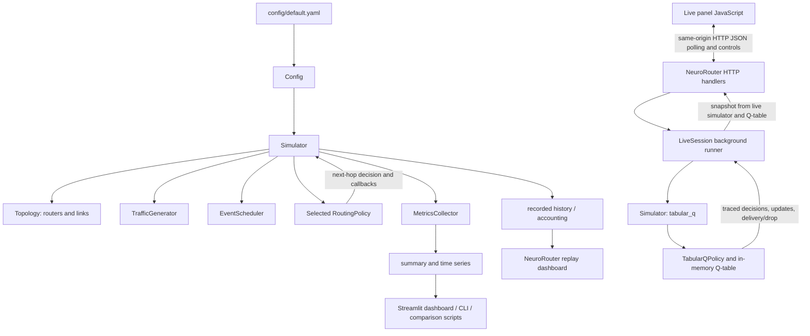

# Project Viva Audit

**Project:** Reinforcement Learning for Adaptive Network Routing: A Simulation-Based, Congestion-Aware Routing System  
**Audit basis:** Read-only inspection of the source tree, configuration, saved artifacts, and tests in this workspace.  
**Scope note:** This report describes the checked-out code, not what the README, UI labels, or an earlier review may claim unless corroborated by implementation.

## 1. Executive summary

This is a Python, discrete-time **network simulation**, not a real router or Internet traffic controller. It creates a graph of simulated routers and directional links, generates synthetic packets, routes them using one of four policies, and measures outcomes. A packet can wait in a finite router queue, consume link capacity, incur a modeled transmission/propagation delay, arrive, expire, or be dropped.

The routing choices implemented are:

1. **Shortest path:** minimum hop-count path over links currently marked up.
2. **Congestion-aware:** a deterministic next-hop heuristic combining remaining hop count, estimated next-router queue delay, and estimated link service/propagation delay.
3. **Tabular Q-learning:** a state/action table and epsilon-greedy next-hop selection, trained online from hop, delivery, and drop rewards.
4. **DQN:** a PyTorch neural Q-function with replay, a target network, optional Double-DQN targets, a dueling head, and online training.

The added NeuroRouter **LIVE Q-LEARNING BRAIN** is substantially connected to the real simulator. It creates a separate `Simulator` configured to use the actual `TabularQPolicy`; the agent reports actual decisions and update inputs through a tracer, and the backend reads Q-values from the agent’s table. The UI polls a local HTTP API and renders this recorded/snapshotted data. It is live while the background runner advances, but it is not connected to a physical network. The displayed decision list is bounded history, and Q-table values in the decision view are current values with a separately recorded “at decision” value where available.

Two project-command problems are confirmed:

- `main.py` and `scripts/run_comparison.py` import `routing_rl.experiment_utils`, but the helper file is `scripts/experiment_utils.py`; neither script can start in the current tree.
- The comparison script’s default experiments file is `config/experiments.yaml`, which does not exist; the checked-in plan is `scripts/experiments.yaml`.

Tests for the core simulator and live Q panel pass when run separately. Full test discovery has one import error because `tests/test_random_topology.py` also imports the missing `routing_rl.experiment_utils`. The browser-oriented jsdom test is skipped because jsdom is not installed. No browser launch or Streamlit launch was verified.

The workspace contains a DQN summary JSON and checkpoint, but the JSON lacks run configuration/metadata and contains fields inconsistent with the current metrics collector. Treat those files as unverified historical artifacts, not validated experiment results. The README’s approximate comparison table is not backed by reproducible result files in this workspace.

## 2. Actual project architecture

### Source tree and responsibilities

| Path | Responsibility and what is actually there |
|---|---|
| [`routing_rl/network/`](./routing_rl/network/) | Simulated router, packet, directional link, topology builders, and topology layouts. |
| [`routing_rl/routing/`](./routing_rl/routing/) | Shared policy interface plus shortest-path, congestion-aware, and tabular policies. |
| [`routing_rl/routing/dqn/`](./routing_rl/routing/dqn/) | DQN agent, neural network, and replay buffer. |
| [`routing_rl/simulation/`](./routing_rl/simulation/) | Synthetic traffic, scheduled network events, discrete-time simulator, and live-session wrapper. |
| [`routing_rl/metrics/`](./routing_rl/metrics/) | Packet outcome counters, summary metrics, rolling time series, and adaptation analysis. |
| [`routing_rl/viz/`](./routing_rl/viz/) | Visualization-related package exists; the inspected dashboard visualization paths primarily use `dashboard/` and topology helpers. |
| [`dashboard/app.py`](./dashboard/app.py) | Streamlit dashboard entry point. |
| [`dashboard/dashboard_core.py`](./dashboard/dashboard_core.py) | Shared scenario validation, simulation execution, KPIs, scoring, event derivation, and JSON conversion for the dashboards. |
| [`dashboard/neurorouter_app.py`](./dashboard/neurorouter_app.py) | Standalone local HTTP server and HTML/canvas NeuroRouter interface, including the API endpoints. |
| [`dashboard/live_panel.py`](./dashboard/live_panel.py) | HTML, CSS, and JavaScript for the live Q-learning panel; injected into the NeuroRouter page. |
| [`scripts/experiment_utils.py`](./scripts/experiment_utils.py) | Configuration overrides, one-run helper, metadata, and statistical helpers. **It is not located in the `routing_rl` package.** |
| [`scripts/run_comparison.py`](./scripts/run_comparison.py) | Repeated experiment runner and aggregation/plot generation; currently blocked by its helper import and default experiments path. |
| [`scripts/experiments.yaml`](./scripts/experiments.yaml) | Experiment plan (methods, seeds, scenarios, and overrides). |
| [`config/default.yaml`](./config/default.yaml) | Active default simulation, traffic, topology, routing reward, and DQN configuration. |
| [`main.py`](./main.py) | Intended single-run CLI and JSON output writer; currently fails at import before argument parsing. |
| [`tests/`](./tests/) | Python unit/integration tests and optional jsdom UI harness. |
| [`results/results_dqn.json`](./results/results_dqn.json) | Existing saved DQN summary; insufficient provenance and inconsistent with the current collector. |
| [`results/dqn_model.pt`](./results/dqn_model.pt) | Existing PyTorch checkpoint file; its training provenance and compatibility were not established. |
| [`README.md`](./README.md) and [`requirements.txt`](./requirements.txt) | Setup/feature claims and Python dependency declarations. |

### Call flow

The live session is separate from the standard NeuroRouter “Run” and “Battle” requests. The latter finish a complete simulation and then display recorded history; the live Q panel creates and advances its own controllable tabular Q-learning simulation.

### Files and configuration details worth noticing

- The default YAML selects `geometric`, `shortest_path`, Poisson traffic, and a scheduled failure; it does not select DQN by default.
- Geometric graphs have a random node count in the configured range (default 10–30), are connected, and label the farthest-hop pair `S` and `D`.
- `requirements.txt` declares PyTorch and Streamlit along with NetworkX, NumPy, PyYAML, Rich, and plotting/scientific libraries. `pywebview` is optional and is not required for the browser mode.
- The audit did not inspect installed package internals or treat virtual-environment contents as project source.

## 3. Networking concepts

| Concept | Basic meaning | Implementation in this project |
|---|---|---|
| Node/router | A point that accepts and forwards packets. | `Router` has an ID, neighbor list, finite queue, and queue-level observation. There is no router OS, forwarding plane, or physical interface. |
| Link | A connection between routers. | `Link` objects are directional. The topology builders generally create a matching object for each direction; a failure event changes both directions when present. |
| Topology | The arrangement of routers and links. | `build_topology` supports geometric, diamond, mesh, scale-free, hierarchical, grid, and ring graphs. A returned NetworkX directed graph is also used for graph information. |
| Source/destination | Packet origin and intended endpoint. | `TrafficGenerator` makes packets with `src`, `dst`, creation time, TTL, and priority class. |
| Next hop/path | The next router selected, and the sequence already traversed. | Each forward appends the current router ID to `packet.path`; destination is appended on delivery. `hop_count` increments on a successful link send. |
| Capacity | Maximum modeled packet send rate. | A link’s `capacity_pps` controls token accumulation and transmit service time. The unit is packets per second, not a measured physical bit rate. |
| Delay | Time for a packet to traverse and queue. | Link service is modeled as `1 / capacity_pps` seconds per packet plus propagation delay. A backlog is represented by a scheduled next transmit start. End-to-end delay is `delivery_time - creation_time`. Router queue waiting contributes to elapsed time while the packet remains queued, rather than a separate calibrated queueing model. |
| Utilization | Fraction of modeled capacity used recently. | `Link.step` smooths the previous step’s sent/capacity ratio into `utilization_ema`. It is a simulation statistic, not a sampled physical-link counter. |
| Congestion | Excess offered work causing queues, delay, and possibly overflow. | Finite router queues, send tokens, queue length/level, link residual capacity, and packet TTL approximate congestion effects. Each router processes at most eight packet forwards per simulation tick. |
| Packet loss | A packet fails to reach the destination. | Queue overflow, link failure while in flight, loop detection, and TTL expiry are separately recorded; packets still queued/in-flight at finalization are unresolved rather than terminal losses. |
| Link failure/recovery | A connection becomes unavailable and may later return. | `EventScheduler` applies scheduled outages or capacity degradations at a simulator tick; the link objects and policy callbacks are updated. In-flight packets on a link going down are drained as lost. |
| Traffic pattern | How packet arrivals occur. | Poisson uses a seeded NumPy generator; constant/bursty patterns use a fractional arrival accumulator. Multi-flow configuration can define separate flows. Packets are generated, not received from sockets. |
| Time | Progress of the modeled experiment. | `Simulator.t` advances by `simulation.dt` (default 0.01 s) per tick. This is simulated time; wall-clock runtime depends on machine speed and policy complexity. |

### End-to-end packet example

For the built-in diamond topology, routers are `S0`, `A`, `B`, and `D0`. There are two two-hop paths: `S0 → A → D0` and `S0 → B → D0`. The `A → D0` link has 15 packets/s capacity while `B → D0` has 120 packets/s; the first edge on each branch has capacity 120 packets/s.

1. The traffic generator creates a packet at `S0` with destination `D0`, a timestamp, TTL, and a priority flag.
2. The simulator enqueues it at `S0`; priority packets are placed ahead of best-effort packets.
3. The selected policy picks a next hop using its own rule.
4. If the link is up and can accept a send, the packet leaves the router, its path/hop count are updated, and a link object schedules arrival.
5. At the next router, the policy chooses again. At `D0`, the simulator records delivery and delay.
6. If a queue is full, an in-flight link fails, the packet loops, or the TTL expires, a corresponding drop/expiry callback and metric are recorded.

This example illustrates why the congestion-aware heuristic or a learner may prefer `B` under load, but no specific route outcome should be claimed without a particular run and seed.

## 4. Routing algorithms

### A. Shortest path

`ShortestPathPolicy` in [`shortest_path.py`](./routing_rl/routing/shortest_path.py) builds a directed graph from currently-up links and calls NetworkX’s `single_source_shortest_path` for every router. This is an unweighted **minimum-hop** calculation, not a minimum-latency or Dijkstra weighted-cost calculation. The path’s second node becomes the next-hop entry.

- When a link status changes, `on_link_change` rebuilds the table.
- It does not factor in queue length, capacity, utilization, or packet priority.
- If no path exists, `select_next_hop` returns `None`. The simulator parks/defer-enqueues that packet and it may later expire.
- It does not inspect the packet’s prior path when making a choice. Simulator loop detection is a separate guard.

### B. Congestion-aware heuristic

`CongestionAwarePolicy` computes candidate costs in [`congestion_aware.py`](./routing_rl/routing/congestion_aware.py):

`cost(n) = hops(n → destination) + α × (queue_delay(n) + β × link_delay(current → n))`

with `β = 1.0` by default and `α = cfg.routing.alpha` (1.5 in the checked-in YAML).

- `hops(n → destination)` is a minimum hop count over currently-up directed links.
- `queue_delay(n) = queue length at n / sum of its up outgoing capacities`, except destination queue delay is zero.
- `link_delay = 1 / max(available_capacity_pps, 1) + propagation_delay`. “Available” capacity is computed from the link’s smoothed utilization.
- Down links, already-visited routers, and candidates with no path to destination are excluded.
- The minimum-cost neighbor is selected; ties preserve neighbor ordering.
- Link events recalculate reachability. Queue and utilization changes affect costs as packets are evaluated.

It is a hand-designed greedy heuristic, not a learned policy. It uses a queue/capacity-based approximation rather than a prediction from a learned model.

### C. Tabular Q-learning

`TabularQPolicy` lives in [`tabular_q.py`](./routing_rl/routing/tabular_q.py).

**State:** `(current_router_id, packet_destination_id, current_router_queue_level)`. Queue level is discretized into three levels (`0`, `1`, `2`) by `Router.queue_level()`. The table does not include source ID, packet priority, path history, or measured link utilization as state fields.

**Action:** a valid neighboring router ID. A neighbor is initially valid only if the directional link exists and is up. If at least one valid neighbor has not appeared in `packet.path`, visited neighbors are excluded. If every up neighbor has been visited, the policy falls back to allowing visited neighbors; the simulator’s loop guard/TTL remains important.

**Q-table representation:** Python dictionary keyed by state tuple, with a nested dictionary from action/neighbor ID to float. Missing entries are treated as `0.0`, but the live UI separately labels them “Unvisited”.

**Selection:**

- With exploration enabled, choose a uniformly random valid action with probability `epsilon`.
- Otherwise choose the valid action with maximum Q-value.
- Ties among greedy actions are broken randomly.
- The implementation defaults are `alpha=0.15`, `gamma=0.92`, `epsilon=0.25`; `epsilon_min=0.02`, `epsilon_decay=0.9992`. Epsilon decays after each successful hop, and the multiplication is not clamped after crossing the minimum, so it can end slightly below the nominal minimum.
- The live controls can turn exploration off without changing epsilon; that makes selection purely greedy.

**Rewards when loaded through the checked-in YAML:**

- Hop forward: `-1.0 + (-2.5 × next_router_queue_level)`.
- If priority packet: multiply that whole hop reward by `1.15`.
- Delivery: `+45.0`, multiplied by `1.3` for priority packets.
- Drop/expiry: `-55.0`.

The tabular policy does not use the `latency_scale` field. It learns about congestion indirectly from the next-router queue-level penalty. It has no direct link-utilization or link-delay term in its reward/state.

**Update equation actually implemented:**

`Q(s,a) ← Q(s,a) + α × [r + γ × max_a′ Q(s′,a′) − Q(s,a)]`

In `_update_q`, `max_next` is the maximum Q among the supplied next valid actions, defaulting to zero when there are none. Delivery/drop are terminal updates with no next actions, so their bootstrap term is zero. A hop-forward update is made after the packet is actually sent. Later delivery/drop updates credit the packet’s still-pending last state/action again with terminal reward; intermediate hops have already had their hop update before the packet’s pending action is replaced at its next router.

One implementation nuance: the hop-forward callback treats the next router as a next state and supplies its currently-up neighbors even when that router is the packet destination. The destination normally has no learned row for that packet’s `(destination, destination, queue-level)` state, so those Q-values are initially zero; on arrival the terminal delivery callback then updates the same pending state/action again with the delivery bonus and no next actions. Thus the final action can receive two sequential updates, not one combined terminal update.

**Drops and loops:** a selected action is recorded only after an actual forward. Packets with no usable link are deferred, not immediately dropped, and may later expire. When the current router is already in the packet path, the simulator drops the packet as a loop. A drop callback updates the last pending state/action if one exists. A packet rejected at the source queue has no routing action yet, so there is no Q transition to update.

### D. Deep Q-Network

DQN is implemented in [`dqn/agent.py`](./routing_rl/routing/dqn/agent.py), with its network in [`dqn/network.py`](./routing_rl/routing/dqn/network.py) and replay storage in [`dqn/replay.py`](./routing_rl/routing/dqn/replay.py). It is separate from tabular Q-learning and is not used by the live Q panel.

- **Input/state vector:** current-router one-hot, destination one-hot, local queue fraction and normalized 0–2 level, padded neighbor queue fractions, padded neighbor residual-capacity ratios, normalized hop count capped at 1, and priority flag.
- **Dimension:** `2 × number_of_routers + 2 + 2 × max_degree + 2`; action dimension equals maximum router degree.
- **Action:** an index into that router’s ordered neighbor list; mask excludes down links and visited nodes. If no unvisited active action exists, it falls back to active visited neighbors.
- **Network:** shared feature MLP with hidden dimensions `[128, 128, 64]` and ReLU. The checked-in configuration enables a dueling head with separate value and advantage streams; Q-values are `V(s) + (A(s,a) - mean_a A(s,a))`.
- **Replay:** bounded deque; samples random batches (not prioritized despite the replay module’s descriptive wording).
- **Training:** Adam, smooth-L1/Huber loss, gradient norm clipping at 5, training every four transitions once the buffer has at least 400 entries, and target-network synchronization every 150 training steps.
- **Double DQN:** when enabled, the policy network chooses the next action and the target network evaluates it. Invalid next actions are masked.
- **Exploration:** epsilon-greedy with configured start `0.95`, end `0.05`, decay `0.9975` in this YAML; DQN defaults in the dataclass differ slightly. PyTorch CPU is configured.
- **Reward:** hop and next-queue-level penalty; priority multiplier 1.2; an age-based latency shaping term; a delivery bonus of 45 (priority multiplier 1.4 plus a nonnegative latency bonus); drop penalty −55.

The DQN sends a nonterminal replay transition on each hop and later an additional terminal transition for the packet’s pending last action on delivery/drop. This is a deliberate consequence of the callback structure, but it means the final action receives both the hop-shaped transition and terminal outcome transition. Source-queue drops occur before an action and are not replay transitions.

**Verification status:** PyTorch was available for tests. The test `test_dqn_still_constructs_when_torch_is_installed` passed, and short policy/topology tests run DQN in a small simulation configuration. This audit did not run a full DQN training experiment or reproduce the saved checkpoint’s results.

## 5. Q-learning mathematics

The tabular code uses the standard one-step off-policy Q-learning equation:

`Q_new(s,a) = Q_old(s,a) + α × [r + γ × max_a′ Q(s′,a′) − Q_old(s,a)]`

- `s`: the current state, here router + destination + current queue level.
- `a`: chosen next-hop router.
- `r`: immediate reward/penalty from the forwarded hop or final outcome.
- `s′`: the next router’s state after the packet is forwarded.
- `max_a′ Q(s′,a′)`: best known estimate from valid next-state actions.
- `α` (alpha): how strongly the new target changes the old estimate.
- `γ` (gamma): how much future estimated reward contributes.
- `Q(s,a)`: learned estimate of future cumulative reward from taking this next hop in this state.

### Clearly hypothetical numerical example

Assume `Q_old=2.0`, `α=0.5`, `r=−1.0`, `γ=0.9`, and `max Q(s′,a′)=3.0`. These values illustrate arithmetic; they are not claimed as a measured project outcome.

1. Target: `−1.0 + 0.9 × 3.0 = 1.7`.
2. Temporal-difference error: `1.7 − 2.0 = −0.3`.
3. Update: `2.0 + 0.5 × (−0.3) = 1.85`.

The result moves halfway from the previous value toward the new target.

A reward can be negative because each hop costs reward and a crowded next queue adds another penalty; a drop gets a large negative penalty. Future reward matters because a hop can be temporarily unattractive but lead to a high-value state. Congestion can make a hop less valuable via queue-level reward and through Q-values accumulated from outcomes. Q-values can change without a route changing because an update may not move the selected action past its competitor; conversely, the route can change because the state changed (queue level, valid links), an outage removed an action, or exploration selected a different action. Learning is not an instantaneous guarantee that the next packet takes a different path.

**Exploration vs exploitation:** exploration chooses randomly among valid actions with probability epsilon; exploitation chooses the currently highest Q-valued valid action. Epsilon-greedy exploration does not mean random movement without constraints: down links and, when possible, looped-to nodes are excluded.

## 6. Live Q-learning panel internals

### What is actually live?

`LiveSession` in [`simulation/live.py`](./routing_rl/simulation/live.py) builds a regular `Simulator` with `routing.method = tabular_q`, disables training side effects not needed for this mode, assigns a private seeded RNG to the policy, and attaches a tracer. A daemon background thread advances the simulator in small chunks while running. A lock protects snapshot/control operations.

The feature is a **combination of current simulator state and recorded event history**:

- Graph, current link states/utilization, current clock, and current Q-table are read from the live simulator/policy.
- Decision and update cards are records emitted when real policy actions/updates occur.
- The timeline/event logs are bounded records, not an invented path replay.
- The normal NeuroRouter canvas animation outside this panel is explicitly a **completed-run replay**; its moving “comets” and sound are decorative, not individual packet traces.

There is no WebSocket. The page uses same-origin JavaScript `fetch`: polling `/api/live/state` about every 500 ms while running and every 1.5 seconds otherwise. Controls issue POSTs. The server binds to `127.0.0.1` on a free port.

### Endpoints

| Endpoint | Purpose |
|---|---|
| `POST /api/live/start` | Construct/replace the live tabular session using the page’s current scenario controls. The server forces method `tabular_q` and disables its scheduled failure; failures in this panel are user-triggered. |
| `POST /api/live/control` | Validate an action and call `LiveSession.control(...)`. |
| `GET /api/live/state` | Return snapshot, focus, timeline, updates, state, and current table-derived values. |
| `GET /api/live/qtable` | Return paged learned state/action entries, optionally filtered by router/destination. |

`do_GET`/`do_POST` route those endpoints in [`neurorouter_app.py`](./dashboard/neurorouter_app.py); malformed/invalid inputs return HTTP 400 and unexpected handler errors return 500 with a terminal traceback.

### Decision, Q-table, and update evidence

1. `TabularQPolicy.select_next_hop` captures the state, candidate action Q-values, visited flags, epsilon, mode, tied greedy set, excluded loops, down links, and selected action. This is a pending selection snapshot; a decision is not displayed as a committed forward until `on_hop_forward` confirms the send.
2. The policy emits an `update` tracer event from its real `_update_q` method after writing `q_table[state][action]`.
3. `_record_update` independently recomputes `q_old + alpha × (reward + gamma × max_next − q_old)` and compares it with the agent’s `q_new` at a relative tolerance of `1e-9 × (1 + |recomputed|)`. `verified` is based on this comparison.
4. `_math` attaches the current table value as `table_now`; it can differ from `q_new` if later updates have since changed that entry.
5. `_focus_rows` reads current Q-values from `policy.q_table`. An unvisited pair is exposed as `q = null`, `q_effective = 0.0`, and shown as “Unvisited (treated as 0.00)”; the UI does not invent an observed table entry.
6. Recorded candidate Q-values preserve what the policy saw at decision time, while `q_at_decision` is shown alongside the current live Q-value when they differ.

Terminal delivery and drop updates have no next actions, so `max_next=0`. The math panel says so for terminal transitions. The state/action values are in-memory; this live session does not write a Q-table file.

### Timeline, WHY panel, and route change logic

- Each actual forwarded hop increments a sequence number and records the time, packet, priority, router, destination, path-so-far, state, candidates, mode, selected next hop, and any prior choice.
- `changed` is computed for `(router, destination)` by comparing the current committed next hop with the previous one. It counts exploration changes too; it is not a claim that a whole end-to-end path necessarily changed.
- The “route map” route path is updated from **delivered packet paths**. It retains current and previous delivered paths and a most-common path over up to 100 deliveries. A path is not declared current merely because a single next-hop action was selected.
- WHY explanations are generated in Python from recorded facts. Labels separate `POLICY` (greedy/exploration/tie), `LEARNED` (Q estimates and update/reward evidence), `OBSERVED` (queue level, down link, loop exclusion), and `NOTE` (including a cause that cannot be determined).
- If no decision/update/delivery/event exists yet, the panel displays empty-state text rather than fake rows.
- Decision/update history defaults to 300 each and is capped at 1,000; the common snapshot returns at most 40 recent entries. Simulation event feed returns at most 20 and control log at most 40. Full Q-table access is paginated (front-end pages 50; backend max page size 200).
- “Step 1 decision” advances simulator ticks until one additional decision is available, then reveals exactly one more decision from the stream. A single simulator tick can generate several forwards; unrevealed decisions are hidden by a cursor. This means the simulator may already have advanced beyond the displayed decision while its Q-table rows still show current values.

### Controls and backend effects

| UI control | Backend action/function | Actual effect |
|---|---|---|
| Start | `play` → `_c_play` (and `POST /api/live/start` if no session) | Clears the step cursor, starts/resumes the background runner; rejects an already-finished episode. |
| Pause | `pause` → `_c_pause` | Stops future runner chunks; it does not reset time or learned values. |
| Step one decision | `step` → `_c_step` | Pauses, advances simulator ticks until the next decision, and reveals one sequence item. Gives up after 400 ticks (4 simulated seconds at `dt=.01`) if no decision. |
| Speed | `speed` → `_c_speed` | Selects one of 0.5, 1, 2, 5, 10, or 25 simulated seconds per wall-clock second as the runner’s target speed. |
| New session from settings | `POST /api/live/start` | Rebuilds a new live session using current page scenario fields; clears old session/history/table. |
| Increase traffic | `traffic` → `_c_traffic` | UI buttons set multiplier ×2 or ×3; “Normal” sets ×1. Backend accepts 0.25–4.0 and updates the actual traffic generator’s rate multiplier. |
| Fail link | `fail_link` → `_c_fail_link` → `Simulator.inject_link_outage` | Schedules a real outage on the chosen link for 1–60 simulated seconds; event applies on the next tick. Both directional link objects are affected by event application. |
| Restore link | `restore_link` → `_c_restore_link` → `Simulator.end_link_outages` | Ends matching active outage event(s) early; the event scheduler restores the link at a subsequent tick. Rejected if there is no active outage. |
| Exploration checkbox | `explore` → `_c_explore` | Toggles `policy.explore_enabled`, switching epsilon-greedy exploration on/off without changing the epsilon scalar. |
| Alpha / gamma Apply | `params` → `_c_params` | Sets alpha in `(0,1]` and gamma in `[0,1)` for future updates only. |
| Reset, keep Q-table | `reset(keep_learning=true)` → `_c_reset` | Pauses and starts a new network/traffic/clock episode, deep-copying Q-table, epsilon, update/exploration counts, alpha/gamma, and exploration setting. |
| Reset, wipe Q-table | `reset(keep_learning=false)` → `_c_reset` | Starts a new episode without prior table; epsilon returns to initial policy default. |

### Limitations / potentially misleading readings

- The feature is truly connected to a running **simulator**, but not to an actual network or production router.
- “Live Q-value” means current in-memory table value at snapshot time. It is not necessarily the value that existed at the selected historical decision; the panel retains a separate `q_at_decision` for that comparison.
- In step mode, several decisions may already have been generated in the same simulation tick; the UI reveals them individually without undoing simulator progress.
- Next-hop route-change counts include exploration choices and compare at one router/destination, not only stable learned policy changes.
- Route-path comparison is based on delivered paths, so before the first packet is delivered the map can state that no route is known even though forwarding decisions have occurred.
- Link delay/utilization displayed for candidates are simulator observations. The tabular Q-policy does not use those values as direct input/reward terms.
- History is bounded and in-memory. Old cards disappear; nothing in this path archives a complete episode.

## 7. Simulation and metrics

### Lifecycle

`Simulator.__init__` seeds Python’s `random` and NumPy, creates topology/links, builds the selected policy and traffic generator, configures metrics, and schedules configured events. `run()` executes `int(duration / dt)` ticks, then finalizes. The live panel instead calls `advance(n)` to run bounded chunks and finalizes at the end.

Within each tick, the simulator:

1. Advances simulated time by `dt`.
2. Applies scheduled events and marks disruption/recovery transitions.
3. Counts in-flight packets discarded by links that just failed.
4. Replenishes per-link capacity tokens.
5. Generates packets and enqueues them at source routers (or records source queue overflow).
6. Processes ready arrivals; expires overdue arrivals; delivers at destination or enqueues at the next router.
7. For each router, forwards up to eight packets while link capacity permits, defers packets with no usable route/link, and expires old queued packets.
8. Samples metrics every `sample_every` ticks and records network history about every 0.25 simulated seconds.

The simulator records a conservation check: generated packets must equal delivered + dropped + expired + still queued + in-transit. `--strict-accounting` causes an assertion on a mismatch. Summary metrics are a post-warm-up cohort, while the conservation report uses all-time raw counters.

### Metric definitions in the current collector

| Metric | Current computation / caveat |
|---|---|
| Packet delivery ratio | `delivered / max(1, generated)` for packets **created at/after warm-up**. A packet still unresolved at run end is not delivered. |
| Packet loss ratio | `(dropped + expired) / max(1, generated)` for that same creation-time cohort. Loop drops are included within `dropped`. |
| Unresolved ratio | `max(0, generated − delivered − dropped − expired) / max(1, generated)`. For a nonempty cohort, delivery + loss + unresolved is intended to sum to 1. |
| Average end-to-end delay | Mean `delivery_time − creation_time` for delivered packets created after warm-up. |
| P50/P95/P99 delay | Percentiles over those delivered-packet delays; P99 is reported as zero if there are 20 or fewer samples. |
| Average hop count | Mean `packet.hop_count` for the cohort’s delivered packets. |
| Throughput time series | Delivered-packet count in a rolling window divided by a span (up to five seconds); units are packets/s, not bits/s. `run_one` later sets `throughput_pps` to the mean of these samples. |
| Instantaneous delivery/loss | Rolling share of terminal outcomes observed in the window. Delivery is `delivered / (delivered + dropped + expired)`; if there are no recent terminal outcomes, the prior value is carried forward. These are completion-time-window figures, not a strict arrival-cohort PDR. |
| Route changes | Incremented when the next-hop choice for `(router, destination)` differs from its previous recorded choice, on a choice at/after warm-up. It can include decisions for packets created before warm-up. |
| Link utilization | Per tick, `used = min(1, packets_sent_last_step / (capacity_pps × dt))`; `utilization_ema = (1 − a) × old_ema + a × used`, where `a = min(1, 2 × dt)`. It is shown in visualizations/panel but is not emitted as a scalar summary metric by `MetricsCollector.summary()`. |
| Adaptation time | The collector estimates pre-event baseline delivery and delay from a 10 s window, then requires delivery within 0.05 of baseline and delay within `max(1.25×baseline, baseline + 20 ms)` for a two-second hold. Recovery is based on sampled rolling metrics, not a control-theory stability proof. |

The dashboard’s other `estimate_adaptation` fallback uses a different rule: delivery ratio must be at least 90% of pre-failure mean for three consecutive samples. That fallback is used only when a summary adaptation value is absent. The collector already supplies its own adaptation fields when applicable, so the two calculations should not be conflated.

### Model limits

The code does not implement IP/TCP/UDP headers, real sockets, retransmissions, routing protocol exchanges, physical bit serialization, link-layer collisions, or actual router hardware. `Packet.size` is a normalized value and link throughput is in packets/s. `queue_wait_time` exists on the packet model but the inspected simulator does not update it as a standalone measured field. Link queues are modeled as serialized in-flight transmissions; router queues are explicit finite queues.

## 8. Experiments and test results

### Experiment plan

`scripts/experiments.yaml` specifies four methods, shortest path as baseline, five seeds `[11,12,13,14,15]`, and fixed topology seed 42. It describes normal load, increasing load (five rate values), burst traffic, and failure/recovery. If expanded as intended, this is eight scenario variants × five seeds × four methods = 160 planned runs. For a scenario/seed, the comparison loop copies the same config and changes only the routing method, so it is designed for paired comparisons.

The intended artifacts from the comparison runner are per-run JSON and time series, `raw_runs.csv`, `comparison_summaries.json`, `failed_runs.json`, `experiment_manifest.json`, and plots. No such aggregate experiment outputs were present in `results/`; only the DQN JSON and `.pt` checkpoint were found.

### Blocking issues

1. **Helper import path:** `main.py`, `scripts/run_comparison.py`, and `tests/test_random_topology.py` import `routing_rl.experiment_utils`. The only matching source is `scripts/experiment_utils.py`. I directly ran `main.py --help` and `scripts/run_comparison.py --help`; both exited before argument parsing with `ModuleNotFoundError: No module named 'routing_rl.experiment_utils'`.
2. **Comparison YAML default path:** `scripts/run_comparison.py` defaults to `config/experiments.yaml`, but this file is absent. The plan exists at `scripts/experiments.yaml`. Even after the import is resolved, the default config path requires correction or an explicit `--experiments` argument.
3. **Full test discovery imports a test file that uses the same nonexistent helper module path**, so its experiment-tool tests do not execute.

### Existing saved DQN JSON

`results/results_dqn.json` contains a summary with `generated=2454`, `delivered=2435`, `dropped=0`, `expired=0`, `loops=15`, and `drop_reasons.loop=4`, plus `delivery_ratio≈0.9923` and delay/hop figures. This file has no config, seed, timestamp, command, or metadata. Under the current collector, loops are a subset of dropped packets and `drop_reasons["loop"]` should match the loop counter. The saved file’s `loops=15` with `dropped=0` and `drop_reasons.loop=4` does not match that current schema. Nineteen generated packets are also unaccounted for by the shown delivered/dropped/expired fields. This suggests a different/older schema or incomplete snapshot; its values cannot be attributed to a reproducible run of the current code. The README’s approximate performance table likewise is not independently verified.

### Commands executed and observed results

All were run from the project root with the existing `.venv` Python executable; no packages were installed.

| Command | Observed result |
|---|---|
| `.\.venv\Scripts\python.exe -m unittest discover -s tests -v` | `Ran 65 tests`; 63 test cases reported `ok`, 1 skipped, and 1 loader error. Error: `tests/test_random_topology.py` cannot import `routing_rl.experiment_utils`. Exit 1. |
| `.\.venv\Scripts\python.exe -m unittest discover -s tests -p test_correctness.py -v` | 13 passed, 0 failures/errors, exit 0. |
| `.\.venv\Scripts\python.exe -m unittest discover -s tests -p test_live_brain.py -v` | 51 tests run: 50 passed, 1 skipped, exit 0. Live math, live table reads, control validation, topology coverage, and HTTP API integration tests passed. A Python `ResourceWarning` about an unclosed test socket was printed during teardown. |
| `.\.venv\Scripts\python.exe main.py --help` | Failed before help with missing `routing_rl.experiment_utils`. |
| `.\.venv\Scripts\python.exe scripts\run_comparison.py --help` | Failed before help with missing `routing_rl.experiment_utils`. |

The skipped live test explicitly says `jsdom not installed`. The test file’s jsdom harness is a DOM test, not proof of a real browser run; it was not executed. Streamlit was not launched. NeuroRouter’s API handlers were exercised by the passing Python HTTP integration tests, but its standalone launcher and visual rendering in an actual browser were not verified.

## 9. Limitations and potential bugs

### Confirmed from source and execution

- The CLI/comparison helper import is broken as described above; current README commands using those entry points will fail until corrected.
- The comparison default scenario YAML path does not match the actual file location.
- `tests/test_random_topology.py` imports the absent helper package path, reducing the coverage of full test discovery.
- The saved DQN artifact is not traceable to a current run and conflicts with current summary conventions.
- The DQN was not evaluated in a fully reproduced multi-seed comparison during this audit.
- The UI has not been validated in an actual browser, and neither dashboard startup was directly checked.

### Model/measurement caveats to explain during a viva

- Results depend on synthetic traffic, graph seed, traffic seed, reward shaping, warm-up, duration, and simulation model. They cannot be generalized to Internet performance.
- Learning policies train online during their run. A comparison therefore includes exploration/training behavior, not a separate frozen-policy evaluation, unless a separate protocol is added.
- A packet’s last tabular Q action (and DQN action) is updated first on forwarding and again on delivery/drop. In the tabular path the forwarding update supplies destination neighbors as candidate next actions; those destination-state values normally remain zero because delivered packets are not forwarded from their destination. This is worth describing as the actual callback behavior rather than presenting the last hop as a single terminal update.
- Tabular state is intentionally small but coarse: it uses current-router queue level and destination, not full network state. Priority affects reward but is absent from its state.
- The loop-avoidance fallback can permit already-visited nodes if every up neighbor has been visited; simulator loop detection/TTL then handles the packet.
- Packets with no route are deferred and may remain unresolved or expire; they are not necessarily counted as immediate route failures.
- Rolling delivery ratio/throughput are based on terminal completions during an observation window. A packet completed in a window may have been generated earlier.
- Adaptation time is an estimator over sampled delivery/delay data and a chosen band/hold rule; it is not a direct proof that a network has converged.
- Link utilization is smoothed and link service is simplified; congestion-aware costs are heuristic quantities, not measured physical latency.
- The standalone app binds loopback only and uses local HTTP. This is appropriate for a local demo, not a multi-user deployment as configured.

## 10. Viva script

### 60-second introduction

“My project is a simulation study of adaptive packet routing. It builds synthetic router topologies, generates traffic, models finite queues and directional links with capacity, delay, and failures, and compares four routing policies: minimum-hop shortest path, a congestion-aware cost heuristic, tabular Q-learning, and a deep Q-network. The Q-learning agent observes its current router, destination, and local queue level, chooses a neighboring router, and updates a Q-table from hop, delivery, and drop rewards. The simulator records packet delivery, loss, delay, hops, route changes, and adaptation estimates. NeuroRouter includes a live teaching panel that exposes actual tabular Q decisions and update calculations from a separate running simulation. The project does not control physical routers or carry real Internet traffic; its results are limited to the assumptions and parameters of this simulator.”

### Three-minute technical explanation

“The system starts with YAML configuration. The `Simulator` uses a seed to build a graph, creates routers and directed links, constructs one routing policy, and initializes the traffic generator, event scheduler, and metrics collector. Each tick advances simulated time, applies failures or recovery events, replenishes link capacity, creates packets, processes arrivals, and forwards packets from router queues.

“The shortest-path baseline computes minimum hop routes over currently-up links and does not account for congestion. The congestion-aware policy evaluates each valid neighbor using remaining hop count plus weighted queue delay and link service/propagation delay. The two learning options are different: tabular Q-learning stores a value for each `(router, destination, queue-level, next-hop)` combination, while DQN maps a richer vector—router and destination one-hots, local and neighbor queues, residual capacities, hops, and priority—to action values using a neural network.

“For tabular learning, epsilon-greedy selection either explores a random valid next hop or exploits the highest-Q action. On a forward it receives a hop cost plus a next-queue penalty; delivery gives a positive terminal bonus and a drop gives a negative terminal penalty. The update moves the old Q-value toward `reward + gamma × best next-state Q`. The Q-table is not a global routing table: it is an estimate used by the learning policy for the state it observes.

“The metrics collector measures a post-warm-up cohort and distinguishes delivered, dropped, expired, and unresolved packets. It calculates delivery/loss ratios, delay and hop percentiles, throughput in packets per second, route changes, and an adaptation estimate following marked link events. Every simulation outcome remains synthetic.

“The live panel uses a local HTTP API. It creates a real tabular Q session, runs it in a background thread, and observes callbacks from the actual policy. Its math panel independently recomputes each update and checks it against the stored Q-table value. It is a live simulation view plus bounded event history—not a physical network monitor. In this checked-out copy the focused simulator and live tests pass, but the top-level CLI and comparison script currently fail because they import a helper from the wrong package path.”

### Step-by-step live demonstration

1. Explain that “Start” creates a new tabular-Q simulator session; no physical network is connected.
2. Point to the scenario label (topology, nodes, seed, source/destination) and initial empty Q-table.
3. Press **Step 1 decision**. Explain the current router, destination, queue level, valid neighbors, and the difference between an unvisited action (initial Q=0) and a learned table entry.
4. Compare the chosen action with the displayed policy mode: greedy/exploit, explore, or greedy tie. State that a random exploration action may differ from the highest-Q action.
5. Show the decision timeline record and WHY panel. Distinguish `POLICY`, `LEARNED`, and `OBSERVED`.
6. Show the update math panel: old Q, alpha, reward breakdown, gamma, next-state maximum, recomputed result, and `verified`. Explain that delivery/drop use zero future value.
7. Press **Start** and then **Pause**. Explain that the background thread advances simulated time and the page polls the HTTP API.
8. Increase traffic and observe queue/values; state that the panel’s link delay/utilization are observations, not direct tabular state inputs.
9. Fail a link on the route. Explain that an event is scheduled and applied on a later simulation tick; the active path changes only if policy decisions/valid links cause it to change.
10. Restore the link and observe event history.
11. Toggle exploration off; explain it makes the policy greedy but does not erase epsilon or learned values.
12. Apply alpha/gamma settings and note they affect future updates only.
13. Compare **keep Q-table** and **wipe Q-table** resets: both reset network/time/history; only the first carries learned policy state.
14. Explain the full Q-table explorer is paged and reflects learned in-memory entries; it is not loaded from a persistent database.

## 11. Viva questions and answers

### General theory

1. **Why can shortest-path routing perform poorly under congestion?**  
   Standard shortest path minimizes its chosen static edge metric (here hop count) and ignores current queue build-up, link use, and offered load. A shortest route can become a bottleneck.

2. **What does reinforcement learning add?**  
   It lets a policy update action values from reward/penalty feedback rather than requiring a fixed route-cost formula. This implementation learns online in the simulation.

3. **What is a state?**  
   A compact representation of conditions relevant to choosing an action. In this tabular policy it is specifically current router, destination, and current router queue level.

4. **What is an action?**  
   A decision available to the agent. Here it is a valid neighboring router (next hop), not an entire end-to-end path.

5. **What is a Q-value?**  
   An estimate of long-term reward from taking an action in a state and continuing under the policy. It is not a probability or guaranteed route quality.

6. **What does alpha do?**  
   It controls how much the latest TD error changes the old estimate. Alpha 1 replaces it with the target; smaller values move gradually.

7. **What does gamma do?**  
   It discounts future estimated reward. Gamma near zero emphasizes immediate reward; a larger gamma gives more weight to future outcomes.

8. **What is exploration versus exploitation?**  
   Exploration samples a valid action to gather experience; exploitation picks the current top-Q action. Epsilon sets the exploration probability when enabled.

9. **Why are rewards often negative?**  
   The project applies per-hop cost and congestion penalties, so extra hops and queueing are discouraged. Successful delivery offsets costs with a positive bonus.

10. **What does a terminal update mean?**  
    No next state is bootstrapped after delivery/drop. The implementation passes no next actions, so max-next-Q is zero.

11. **How is a route different from a next hop?**  
    A next hop is one local forwarding choice. A route/path is a sequence of hops; it may vary packet by packet and is only confirmed in the live map for delivered packets.

12. **What is congestion?**  
    Offered traffic competing for finite queues and link service capacity, producing queue growth, delay, and possible overflow/expiry.

13. **What is packet delivery ratio?**  
    In this project’s summary, delivered packets in the post-warm-up generated cohort divided by generated packets in that cohort. End-of-run unresolved packets are neither delivery nor loss.

14. **Why use multiple seeds?**  
    Traffic arrivals and learning choices vary; repeated seeds help measure variation rather than overstate one lucky/unlucky run. The checked-in experiment plan proposes five seeds.

### Code-specific implementation questions

15. **What exact state does tabular Q-learning use?**  
    `(router.id, packet.dst, router.queue_level())`, with three queue levels. It does not include priority or link utilization.

16. **What action does it select?**  
    A currently-up neighboring router ID. It excludes visited nodes if any unvisited active neighbor exists.

17. **How are initial Q-values represented?**  
    Missing state/action pairs return 0.0. The live panel labels them unvisited rather than claiming they are learned values.

18. **What is the checked-in YAML’s tabular hop reward?**  
    `-1.0 - 2.5 × next_router_queue_level`; priority multiplies the hop total by 1.15. Delivery is +45 (priority ×1.3); drop is −55.

19. **Does tabular Q directly observe link utilization?**  
    No. It observes local queue level in its state and gets a next-router queue penalty in reward. The panel may display utilization, but that is for observation/explanation.

20. **What happens when a link goes down?**  
    The event scheduler changes both link directions when available, drains in-flight packets as link-failure losses, invokes the policy’s link-change callback, and the routing policy sees the link as unusable.

21. **Does the live WHY panel infer causes from a separate AI model?**  
    No. Python constructs explanations from recorded policy mode, candidate Q-values, queue level, link status, loop exclusion, route changes, and update records. If evidence is insufficient it says the cause is unavailable.

22. **How does the live panel validate the displayed equation?**  
    It recomputes the update from recorded old Q, alpha, reward, gamma, and max-next Q, compares that to the actual `q_new` written by the policy, and reports the tolerance check.

23. **Does the live panel show historic Q values exactly as they were at the timeline event?**  
    It records candidate values at decision time, but its main “live” Q table reads current policy values. It labels `q_at_decision` where the current value changed.

24. **Is “Step 1 decision” the same as advancing exactly one packet-forwarding event?**  
    It advances whole simulator ticks until a decision exists, then reveals one more record. A tick can create multiple decision records, so hidden records may already be in the history.

25. **What is the DQN’s input and output?**  
    A vector of one-hot router/destination, local/neighbor queues, residual capacities, hop count, and priority; outputs one Q estimate per padded neighbor slot, masked for invalid actions.

26. **What makes the DQN “Double” and “Dueling”?**  
    Double-DQN selects a next action with the policy network and evaluates it with the target network. Dueling estimates state value and per-action advantage separately.

27. **What are the DQN optimizer and loss?**  
    Adam and smooth-L1/Huber loss, with gradient norm clipping. Replay is a uniformly sampled bounded deque.

28. **What exactly is adaptation time?**  
    The collector compares rolling sampled delivery and average delay to a pre-disruption baseline; it requires a tolerance band to persist for two seconds. It is a metric definition, not proof of protocol convergence.

29. **Does throughput mean Mbps?**  
    No. It is packets per second in this simulator. There is no meaningful physical bits-per-second measurement because packet sizes are normalized.

30. **Why are packets left unresolved at simulation end?**  
    The run stops at configured duration; packets may still be queued or in flight. Accounting reports them separately instead of incorrectly calling them lost.

31. **Are the example DQN results in README established by this audit?**  
    No. The README has approximate figures, and the saved DQN JSON lacks provenance and conflicts with current loop/drop fields. The comparison runner also cannot start in the checked-out tree.

32. **What did the tests establish?**  
    The correctness tests and live-feature tests passed separately, including Q-value/table authenticity, update math, controls, topology coverage, and HTTP API tests. Browser UI test was skipped; full discovery hit a helper-import error.

33. **Can this code configure an actual network router?**  
    No. It models packets, queues, links, and route choices in Python. It has no real network interface or routing protocol deployment.

34. **What should be improved before presenting comparative performance claims?**  
    Fix the script imports and experiments path, run the planned paired repeated experiments, preserve config/seed/software metadata with each result, and separate training from evaluation if comparing frozen learned policies.

### Difficult follow-ups / misconceptions to avoid

- Do not say “the model sees the whole network” for tabular Q-learning. Its state is local and coarse.
- Do not say the tabular learner uses link delay or utilization just because the panel shows those observations.
- Do not call the heuristic “AI learning”; it is a cost-based rule.
- Do not claim the dashboard is controlling real routers or monitoring real traffic.
- Do not claim a green/most-used path is necessarily globally optimal; it is a recent delivered-path display.
- Do not interpret Q-values as probabilities.
- Do not claim Q-learning changes the route immediately after a failure; action validity, state, history, exploration, and values all matter.
- Do not claim “zero packet loss” when unresolved packets exist; report delivered, dropped, expired, and unresolved separately.
- Do not call `throughput_pps` Mbps or equate it to measured Internet throughput.
- Do not claim DQN superiority using the README example table or current saved JSON without reproducible metadata.
- Do not say the browser UI test passed; jsdom was skipped and no real browser was exercised.
- Do not claim the complete project test suite passes; full discovery has one test-module import error.

## 12. Important code files to study first

1. [`config/default.yaml`](./config/default.yaml) — actual default values and scheduled event.
2. [`routing_rl/simulation/simulator.py`](./routing_rl/simulation/simulator.py) — lifecycle, packet processing, forwarding, accounting.
3. [`routing_rl/routing/tabular_q.py`](./routing_rl/routing/tabular_q.py) — state, action, reward, update, epsilon-greedy rule.
4. [`routing_rl/simulation/live.py`](./routing_rl/simulation/live.py) — real live session, records, controls, snapshots, equation verification.
5. [`dashboard/live_panel.py`](./dashboard/live_panel.py) — which live-panel controls call which endpoints and how data is rendered.
6. [`dashboard/neurorouter_app.py`](./dashboard/neurorouter_app.py) — local HTTP server, endpoint routing, replay/stream separation.
7. [`routing_rl/routing/congestion_aware.py`](./routing_rl/routing/congestion_aware.py) and [`routing_rl/routing/shortest_path.py`](./routing_rl/routing/shortest_path.py) — non-learning baselines.
8. [`routing_rl/metrics/collector.py`](./routing_rl/metrics/collector.py) — metric definitions and formulas.
9. [`routing_rl/routing/dqn/agent.py`](./routing_rl/routing/dqn/agent.py) — neural state/action and training.
10. [`tests/test_live_brain.py`](./tests/test_live_brain.py) and [`tests/test_correctness.py`](./tests/test_correctness.py) — executable evidence for intended behavior.
11. [`scripts/run_comparison.py`](./scripts/run_comparison.py) and [`scripts/experiment_utils.py`](./scripts/experiment_utils.py) — intended experiment procedure, noting the import/path defects.

## 13. Glossary of technical terms

- **Action:** Choice available to a policy; here a next-hop router.
- **Adaptation time:** Time until a chosen performance metric returns to a defined band after an event.
- **Capacity:** Modeled maximum packet service rate for a link.
- **Congestion:** Queueing and resource contention when offered work approaches/exceeds service capacity.
- **Discount factor (gamma):** Weight applied to future Q-value estimates.
- **DQN:** Neural-network approximation of action values instead of a discrete table.
- **Double DQN:** Variant that separates next-action selection and evaluation between online and target networks.
- **Dueling network:** DQN architecture estimating state value and action advantage streams.
- **Epsilon-greedy:** Policy that explores randomly with probability epsilon and otherwise exploits the best known action.
- **Experience replay:** Stored transitions sampled later for neural-network training.
- **Hop:** One successful router-to-router forwarding operation.
- **Link utilization EMA:** Smoothed recent ratio of modeled sent packets to available capacity.
- **Next hop:** Immediate router a packet is sent to.
- **Packet TTL:** Simulated lifetime; packets older than it expire.
- **Q-table:** Mapping from tabular states/actions to learned scalar estimates.
- **Queue level:** Discrete local queue-occupancy bin, 0 through 2 in the router implementation.
- **Replay buffer:** DQN’s bounded store of state/action/reward/next-state transitions.
- **Reward:** Immediate scalar feedback used by a learning update.
- **State:** Information passed to the policy for a routing choice.
- **Terminal transition:** An outcome with no next state to bootstrap from, such as delivery/drop.
- **Topology seed:** Seed that fixes generated network layout separately from traffic/learning seed.
- **Unresolved packet:** Packet still queued/in transit when simulation duration ends.
- **Warm-up:** Initial interval excluded from cohort summary statistics.

## 14. Unverified details and remaining work

- No actual browser session was tested. The jsdom test was skipped because the dependency is absent; no package installation was performed.
- The Streamlit application was not launched or visually inspected.
- NeuroRouter’s Python HTTP API was covered by tests, but the standalone launcher/browser UX was not independently tested.
- The DQN checkpoint was not loaded or validated against the current DQN architecture; provenance is unknown.
- No full DQN training run, multi-seed comparison, or README performance reproduction was conducted.
- No real network, physical router, Internet traffic, packet capture, or protocol implementation exists in the inspected code.
- The exact provenance of `results/results_dqn.json` and `results/dqn_model.pt` could not be established.
- The helper import and experiments YAML path defects prevent the documented CLI/comparison workflow from running without code/config changes. No such changes were made because this was requested as a read-only audit.
